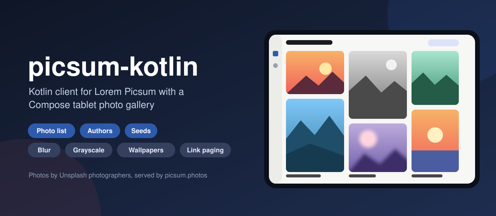
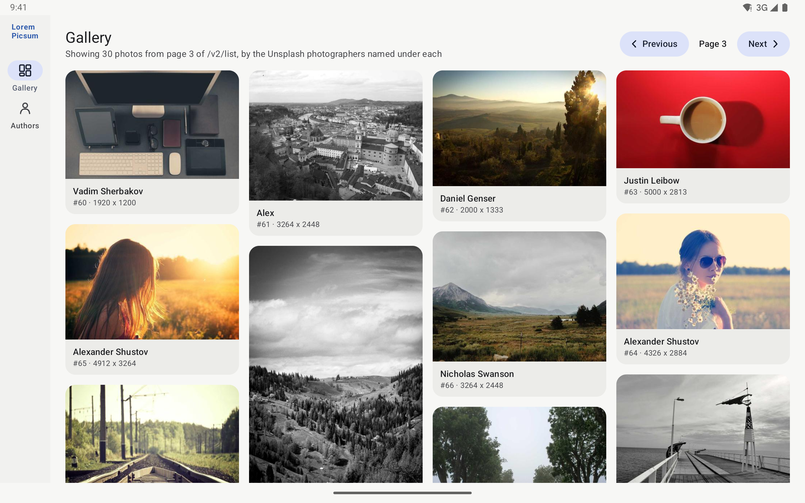
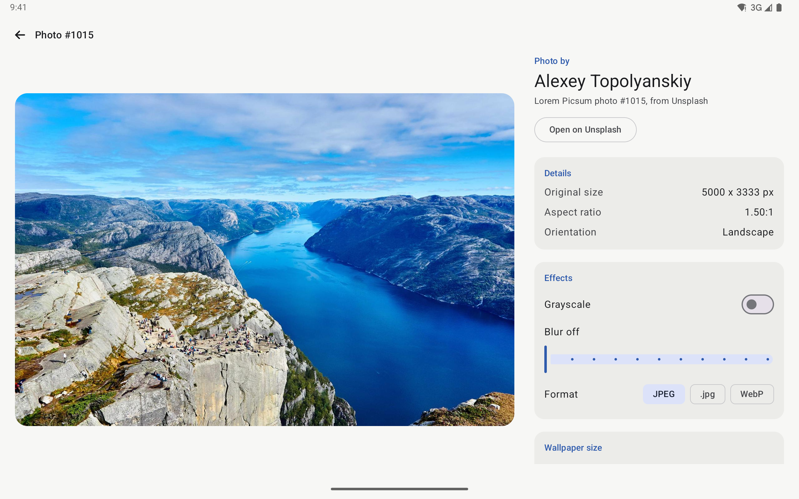
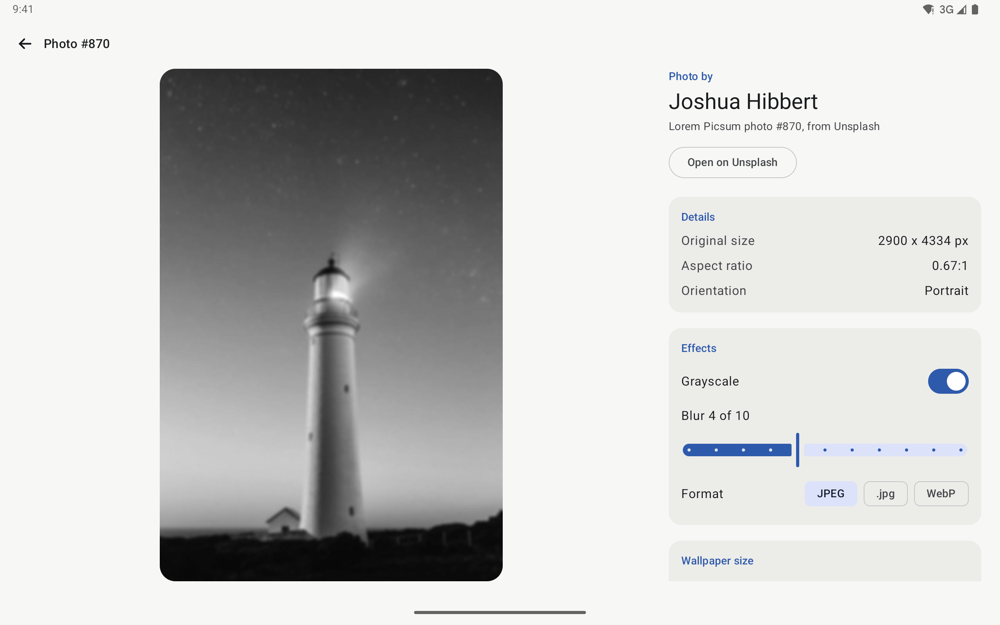
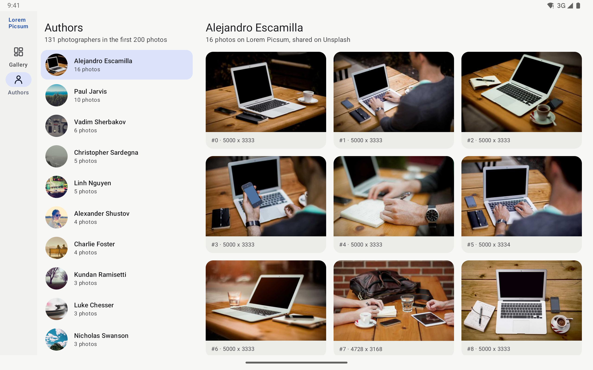

<p align="center">
  
</p>

<p align="center">
  <a href="https://github.com/halilozel1903/picsum-kotlin/actions/workflows/ci.yml"></a>
  <a href="https://jitpack.io/#halilozel1903/picsum-kotlin"></a>
  
  
  
  
  
  <a href="LICENSE"></a>
</p>

**picsum-kotlin** is a Kotlin client for [Lorem Picsum](https://picsum.photos), the free placeholder photo service. It loads the photo list (with paging from the `Link` header) and photo info by id or seed, builds image urls with grayscale, blur, formats and cache-busting random images, and does the aspect ratio math for thumbnails, previews and device wallpapers. The client is pure Kotlin/JVM (Ktor, kotlinx.serialization, coroutines), so it runs on Android, on the server and in tests. The sample is a Jetpack Compose photo gallery for Android tablets.

> **Photos by Unsplash photographers.** Every photo on Lorem Picsum comes from [Unsplash](https://unsplash.com). Each `Photo` carries its photographer (`author`) and its Unsplash page (`url`), and the sample shows the author with every photo. Lorem Picsum is made by [David Marby and Nijiko Yonskai](https://github.com/DMarby/picsum-photos). This project is not affiliated with Lorem Picsum or Unsplash.

```kotlin
val client = PicsumClient()

val page = client.list(page = 1, limit = 30)       // 30 photos, plus page.next from the Link header
val photo = page.photos.first()
photo.author                                       // the Unsplash photographer
photo.thumbnail(480).url                           // https://picsum.photos/id/0/480/320

val puppy = client.photo("237")                    // GET /id/237/info
puppy.fitting(1200, 800).grayscale().blur(2).url   // https://picsum.photos/id/237/1200/718?grayscale&blur=2
puppy.wallpaper(WallpaperSize.PixelTablet).url     // https://picsum.photos/id/237/2560/1600

Picsum.seed("user-42", 96).webp().url              // https://picsum.photos/seed/user-42/96/96.webp
Picsum.random(400, 300, cacheBuster = 3).url       // https://picsum.photos/400/300?random=3
```

## Screenshots

Captured live from picsum.photos by CI, with the sample app on a Pixel Tablet emulator in landscape. The photos, authors and sizes are real data loaded from the API and Picsum's image CDN during the run. There is no fallback data: if a scene cannot load its data or every photo on screen, the screenshot step fails instead.

| Gallery | Photo detail |
| :---: | :---: |
|  |  |
| **Grayscale and blur** | **Authors** |
|  |  |

## Features

- **The whole public API**: `/v2/list` with `page` and `limit`, `/id/{id}/info` and `/seed/{seed}/info`.
- **Link header paging**: every `PhotoPage` carries `next` and `previous` from the response's `Link` header. Follow them with `next(page)` / `previous(page)`, or collect `pages()` and `photos()` Flows that stop at the last page.
- **Image url builder**: `/id/{id}/{w}/{h}`, `/seed/{seed}/{w}/{h}` and random `/{w}/{h}`, with `?grayscale`, `?blur=1..10`, `.jpg` / `.webp`, and `?random=n` to keep several random images on one screen apart. `PicsumImage` is immutable, so one photo turns into many variants.
- **Typed models**: `Photo` (`id`, `author`, `width`, `height`, `url`, `downloadUrl`) with `size`, `aspectRatio`, orientation and `unsplashId`; `PhotoPage`, `PageRequest`; `AuthorPhotos` from `groupByAuthor()`.
- **Size helpers**: `PhotoSize` with aspect fit (`fitInside`), aspect fill (`fill`), `withWidth` / `withHeight` and `limitedTo` Picsum's 5000 px maximum; `Photo.thumbnail`, `fitting`, `original` and `wallpaper` build urls at the right size.
- **Wallpaper sizes**: presets for phones, tablets and desktops (Pixel 9 Pro, iPhone 16 Pro, Pixel Tablet, 13" iPad Pro, 1080p to 4K and ultrawide) and `WallpaperSize.forScreen(w, h)` for the device at hand.
- **Coroutines and clear errors**: main-safe `suspend` functions that throw a `PicsumException` (`NotFound`, `Http`, `Network`, `Decoding`). Network failures, 429 and 5xx are retried with backoff.
- **Pluggable HTTP**: Ktor with CIO by default; pass OkHttp, Android, Java or a `MockEngine`, a ready `HttpClient`, or your own `PicsumTransport`.
- **Explicit API**, unit tested against JSON fixtures in Picsum's response shapes.

### API coverage

| Endpoint or url | Function | Returns |
| --- | --- | --- |
| `GET /v2/list?page=&limit=` | `list(page, limit)`, `list(request)`, `next(page)`, `previous(page)` | `PhotoPage` |
| `GET /v2/list`, every page | `pages(limit, startPage, maxPages)`, `photos(limit, maxPages)` | `Flow<PhotoPage>`, `Flow<Photo>` |
| `GET /id/{id}/info` | `photo(id)` | `Photo` |
| `GET /seed/{seed}/info` | `photoForSeed(seed)` | `Photo` |
| `/id/{id}/{w}/{h}` | `Picsum.id(id, w, h)`, `photo.image(w, h)`, `client.image(id, w, h)` | `PicsumImage` |
| `/seed/{seed}/{w}/{h}` | `Picsum.seed(seed, w, h)`, `client.seedImage(seed, w, h)` | `PicsumImage` |
| `/{w}/{h}?random=n` | `Picsum.random(w, h, cacheBuster)`, `client.randomImage(...)` | `PicsumImage` |
| `?grayscale`, `?blur=n` | `.grayscale()`, `.blur(n)`, `.noBlur()` | `PicsumImage` |
| `.jpg`, `.webp` | `.jpg()`, `.webp()`, `.format(ImageFormat)` | `PicsumImage` |
| Any url | `fetch(url, deserializer)`, `url(path)` | `T`, `String` |

## Installation

Add JitPack to `settings.gradle.kts`:

```kotlin
dependencyResolutionManagement {
    repositories {
        google()
        mavenCentral()
        maven("https://jitpack.io")
    }
}
```

Then the dependency:

```kotlin
dependencies {
    implementation("com.github.halilozel1903.picsum-kotlin:picsum:1.0.0")

    // Optional: use OkHttp instead of Ktor's CIO engine.
    implementation("io.ktor:ktor-client-okhttp:3.6.0")
}
```

> The build is also set up for Maven Central (`io.github.halilozel1903:picsum`) via the vanniktech publish plugin.

`picsum` is a plain Kotlin/JVM library (JDK 17+) and works on any Android API level.

## Usage

**Create a client**

```kotlin
val client = PicsumClient {
    engine = OkHttp.create()            // default: CIO
    userAgent = "my-app/1.0 (+https://example.com)"
    requestTimeoutMillis = 15_000
    maxRetries = 2                      // network errors, 429 and 5xx
    retryDelayMillis = 500              // doubles for each retry
}
// ...
client.close()
```

Image urls need no client: `Picsum.id(...)`, `Picsum.seed(...)` and `Picsum.random(...)` are plain functions. Hand the `url` to Coil, Glide or any image loader; Picsum answers with a redirect to its CDN, which they all follow.

**Pages and the Link header**

```kotlin
val first = client.list(page = 1, limit = 30)
first.next?.page                         // 2, from Link: <...page=2&limit=30>; rel="next"
first.previous                           // null on the first page

val second = client.next(first)          // follows the url the server gave
client.previous(second!!)

client.pages(limit = 100, maxPages = 3).collect { page -> show(page.photos) }
val photos = client.photos(limit = 100, maxPages = 2).toList()   // the first 200 photos
```

`limit` is 1 to 100 (Picsum's default is 30). A page past the end is empty and has no `next`, and the Flows stop there.

**Photo info**

```kotlin
val photo = client.photo("1015")         // or photo(1015)
photo.author                             // the photographer
photo.url                                // the photo's Unsplash page
photo.downloadUrl                        // the original size on Picsum
photo.size                               // PhotoSize(width, height)
photo.isLandscape

client.photoForSeed("picsum")            // the photo /seed/picsum/{w}/{h} shows
```

Picsum's ids are numeric text and have gaps; a missing id throws `PicsumException.NotFound`.

**Image urls**

```kotlin
val base = Picsum.id("870", 1200, 800)
base.url                                 // https://picsum.photos/id/870/1200/800
base.grayscale().url                     // ...?grayscale
base.blur(4).url                         // ...?blur=4 (1 to 10, 0 is off)
base.grayscale().blur(2).webp().url      // https://picsum.photos/id/870/1200/800.webp?grayscale&blur=2

Picsum.seed("avatar-${user.id}", 96).url // the same photo for the same seed, every time

// Several random images on one screen: give each its own cache buster.
(1..6).map { Picsum.random(300, 200, cacheBuster = it).url }
```

**Sizes and wallpapers**

```kotlin
photo.thumbnail(480)                     // 480 px wide at the photo's aspect ratio
photo.fitting(1600, 1200)                // as large as fits, never upscaled
photo.original()                         // the original size, scaled to Picsum's 5000 px limit
photo.wallpaper(WallpaperSize.IPhone16Pro)   // cropped around the center to 1206 x 2622

val screen = WallpaperSize.forScreen(widthPx, heightPx)
photo.wallpaper(screen).url

PhotoSize(6000, 4000).fitInside(PhotoSize(1200, 1200))   // 1200 x 800
PhotoSize(6000, 4000).fill(PhotoSize(1600, 1600))        // 2400 x 1600
aspectFit(source, bounds); aspectFill(source, bounds)
WallpaperSize.presets(DeviceCategory.Tablet)
```

**Authors**

```kotlin
val authors = client.photos(limit = 100, maxPages = 2).toList().groupByAuthor()
authors.first().author                   // the photographer with the most photos
authors.first().count
```

**Errors**

```kotlin
try {
    client.photo("86")
} catch (e: PicsumException.NotFound) {
    // no photo with that id
} catch (e: PicsumException.Http) {
    // e.status after the retries
} catch (e: PicsumException.Network) {
    // offline or timed out
}
```

**Testing your code**

Pass a Ktor `MockEngine` as `engine`, as this library's own tests do, or replace HTTP entirely:

```kotlin
val client = PicsumClient {
    transport = PicsumTransport { url -> PicsumResponse(fixtures.getValue(url), mapOf("Link" to links[url].orEmpty())) }
}
```

## Sample app

The `sample` module is a photo gallery for Android tablets, with a navigation rail:

- **Gallery**: one page of the photo list in a staggered grid, each photo at its own aspect ratio with its photographer, id and original size. Previous and next follow the `Link` header.
- **Photo detail**: a large preview next to the photographer (with a link to the photo on Unsplash), the original size, aspect ratio and orientation; live **grayscale**, **blur** (0 to 10) and **format** controls that rebuild the Picsum url and reload the preview while the previous image stays on screen; a **wallpaper size picker** (this screen, phone, tablet and desktop presets) that previews the crop; and the full-size url to copy.
- **Authors**: the first 200 photos (two pages of 100, followed through the `Link` header) grouped by photographer, most photos first, with the selected photographer's photos.

For screenshots it opens a fixed screen from an intent extra (used by `scripts/screenshots.sh`):

```bash
./gradlew :sample:installDebug
adb shell am start -n io.github.halilozel1903.picsum.sample/.MainActivity --es scene tablet-effects
```

`scene` is one of `tablet-gallery` (page 3 of the list), `tablet-detail` (photo 1015), `tablet-effects` (photo 870 with grayscale and blur 4) or `tablet-authors`. Scenes load live data through the same client as a normal launch and log `SCENE_READY` once the data and every photo on screen have loaded. CI captures them on a Pixel Tablet in landscape and fails instead of capturing when a scene shows an error, does not finish loading, misses the expected text or is blank. There is no offline or demo data in the sample.

## Project structure

| Module | What it is |
| --- | --- |
| `picsum` | Pure Kotlin/JVM: `PicsumClient`, `Picsum` / `PicsumImage` url builder, `PhotoSize`, `WallpaperSize`, models. Published as `picsum` |
| `sample` | The Compose tablet gallery, with screenshot scenes |

## Tech stack

Kotlin 2.4 · Ktor 3.6 (CIO, OkHttp) · kotlinx.serialization · kotlinx.coroutines · AGP 9.4 with built-in Kotlin · Gradle 9.6 · Jetpack Compose (BOM 2026.09) · Material 3 · Coil 3 (sample) · GitHub Actions with Android emulators

## Credits

- **[Lorem Picsum](https://picsum.photos)** serves the photos and the API, free and without a key. It is an open source project by David Marby and Nijiko Yonskai ([source](https://github.com/DMarby/picsum-photos)).
- **The photos come from [Unsplash](https://unsplash.com)** and belong to their photographers. Each photo's `author` is its photographer and `url` its Unsplash page; the sample shows the author with every photo and links to the Unsplash page from the detail screen. Please credit photographers the same way in your app, and check the [Unsplash license](https://unsplash.com/license) before using a photo beyond placeholders.

This project is not affiliated with Lorem Picsum or Unsplash.

## License

MIT. See [LICENSE](LICENSE).
